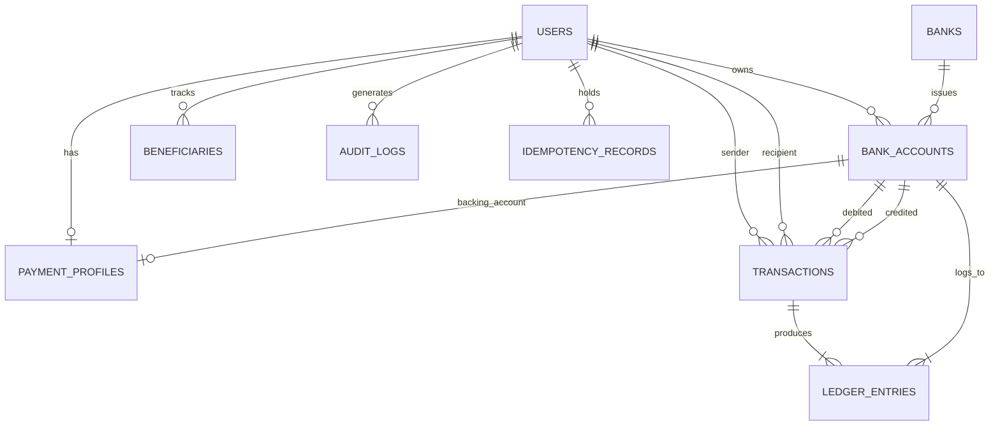

# VaultPay Database Architecture & Relational Design

**Database Engine**: MySQL 8.0+ (InnoDB)  
**Character Set**: `utf8mb4`  
**Collation**: `utf8mb4_unicode_ci`  
**Financial Precision**: `DECIMAL(18,2)` (Zero floating-point rounding errors)

---

## 1. Architectural Overview & Normalization

The VaultPay relational database is designed strictly in **Third Normal Form (3NF)** to ensure zero data redundancy, complete referential integrity, and compliance with banking ACID transactional standards.

### Core Design Principles:
1. **Authoritative Financial State**:
   - Account balances are never trusted from the client.
   - Balances are stored in `bank_accounts` and updated atomically alongside immutable double-entry records in `ledger_entries`.
2. **Double-Entry Bookkeeping**:
   - Every financial movement creates two balanced entries in `ledger_entries` (one debit and one credit).
   - `vw_ledger_audit` verifies that total credits minus total debits equals zero at all times.
3. **Pessimistic Concurrency & Deadlock Prevention**:
   - Transfers lock account rows using `SELECT ... FOR UPDATE` in strict ascending order of account IDs (`LEAST(sender_id, recipient_id)` followed by `GREATEST(...)`).
4. **Data Types**:
   - Money: `DECIMAL(18,2)` with `CHECK (balance >= 0.00)`
   - Keys: Big integers with foreign keys (`ON DELETE RESTRICT` for financial entities)

---

## 2. Entity-Relationship Schema

---

## 3. Table Catalog

### 3.1 `users`
Stores user credentials, hashed passwords, contact info, and roles.
- `id` (BIGINT, PK, AUTO_INCREMENT)
- `full_name` (VARCHAR(100), NOT NULL)
- `email` (VARCHAR(150), NOT NULL, UNIQUE)
- `password_hash` (VARCHAR(255), NOT NULL) — bcrypt (10 rounds)
- `phone_number` (VARCHAR(20), UNIQUE, NULL)
- `role` (ENUM('customer', 'admin'), NOT NULL, DEFAULT 'customer')
- `is_active` (BOOLEAN, NOT NULL, DEFAULT TRUE)
- `created_at` (TIMESTAMP, DEFAULT CURRENT_TIMESTAMP)
- `updated_at` (TIMESTAMP, ON UPDATE CURRENT_TIMESTAMP)

### 3.2 `banks`
Fictional banking institutions participating in the simulated payment network.
- `id` (INT, PK, AUTO_INCREMENT)
- `bank_name` (VARCHAR(100), NOT NULL, UNIQUE)
- `bank_code` (VARCHAR(20), NOT NULL, UNIQUE) e.g., `APEX`, `HORIZON`
- `ifsc_prefix` (VARCHAR(10), NOT NULL, UNIQUE) e.g., `APEX0001`
- `logo_url` (VARCHAR(255), NULL)
- `is_active` (BOOLEAN, DEFAULT TRUE)

### 3.3 `bank_accounts`
Authoritative store of account numbers, IFSC codes, types, and real-time balances.
- `id` (BIGINT, PK, AUTO_INCREMENT)
- `user_id` (BIGINT, NOT NULL, FK -> `users.id`)
- `bank_id` (INT, NOT NULL, FK -> `banks.id`)
- `account_number` (VARCHAR(30), NOT NULL, UNIQUE)
- `ifsc_code` (VARCHAR(20), NOT NULL)
- `account_type` (ENUM('savings', 'current'), DEFAULT 'savings')
- `balance` (DECIMAL(18,2), NOT NULL, DEFAULT 0.00, `CHECK (balance >= 0)`)
- `currency` (VARCHAR(3), NOT NULL, DEFAULT 'INR')
- `is_primary` (BOOLEAN, NOT NULL, DEFAULT TRUE)
- `status` (ENUM('active', 'frozen', 'closed'), NOT NULL, DEFAULT 'active')

### 3.4 `payment_profiles`
Simulated UPI/VPA payment handles (e.g. `username@vaultpay`) and QR payloads.
- `id` (BIGINT, PK, AUTO_INCREMENT)
- `user_id` (BIGINT, NOT NULL, UNIQUE, FK -> `users.id`)
- `primary_account_id` (BIGINT, NOT NULL, FK -> `bank_accounts.id`)
- `vaultpay_id` (VARCHAR(100), NOT NULL, UNIQUE)
- `qr_code_payload` (VARCHAR(255), NOT NULL, UNIQUE)
- `status` (ENUM('active', 'disabled'), DEFAULT 'active')

### 3.5 `transactions`
Master ledger header for all transfers, demo deposits, and demo withdrawals.
- `id` (BIGINT, PK, AUTO_INCREMENT)
- `reference_id` (VARCHAR(64), NOT NULL, UNIQUE)
- `idempotency_key` (VARCHAR(128), NULL, UNIQUE)
- `sender_user_id` (BIGINT, NULL, FK -> `users.id`)
- `recipient_user_id` (BIGINT, NULL, FK -> `users.id`)
- `sender_account_id` (BIGINT, NULL, FK -> `bank_accounts.id`)
- `recipient_account_id` (BIGINT, NULL, FK -> `bank_accounts.id`)
- `type` (ENUM('transfer', 'deposit', 'withdrawal'), NOT NULL)
- `amount` (DECIMAL(18,2), NOT NULL, `CHECK (amount > 0)`)
- `fee` (DECIMAL(18,2), NOT NULL, DEFAULT 0.00)
- `status` (ENUM('pending', 'completed', 'failed', 'reversed'), DEFAULT 'pending')
- `note` (VARCHAR(255), NULL)
- `failure_reason` (VARCHAR(255), NULL)
- `created_at` (TIMESTAMP)
- `completed_at` (TIMESTAMP, NULL)

### 3.6 `ledger_entries`
Double-entry accounting records.
- `id` (BIGINT, PK, AUTO_INCREMENT)
- `transaction_id` (BIGINT, NOT NULL, FK -> `transactions.id`)
- `account_id` (BIGINT, NOT NULL, FK -> `bank_accounts.id`)
- `entry_type` (ENUM('debit', 'credit'), NOT NULL)
- `amount` (DECIMAL(18,2), NOT NULL)
- `balance_after` (DECIMAL(18,2), NOT NULL)
- `description` (VARCHAR(255), NOT NULL)

### 3.7 `beneficiaries`
Frequent or recent payees for fast re-transfer.
- `id` (BIGINT, PK, AUTO_INCREMENT)
- `user_id` (BIGINT, NOT NULL, FK -> `users.id`)
- `payee_user_id` (BIGINT, NOT NULL, FK -> `users.id`)
- `payee_vaultpay_id` (VARCHAR(100), NOT NULL)
- `last_transacted_at` (TIMESTAMP, DEFAULT CURRENT_TIMESTAMP)

### 3.8 `audit_logs`
Regulatory compliance and administrative event tracking.
- `id` (BIGINT, PK, AUTO_INCREMENT)
- `user_id` (BIGINT, NULL, FK -> `users.id`)
- `action` (VARCHAR(100), NOT NULL)
- `entity_type` (VARCHAR(50), NOT NULL)
- `entity_id` (VARCHAR(64), NULL)
- `ip_address` (VARCHAR(45), NULL)
- `user_agent` (VARCHAR(255), NULL)
- `metadata` (JSON, NULL)

### 3.9 `idempotency_records`
Prevents duplicate financial execution when network requests retry.
- `id` (BIGINT, PK, AUTO_INCREMENT)
- `key_hash` (VARCHAR(64), NOT NULL, UNIQUE)
- `user_id` (BIGINT, NOT NULL, FK -> `users.id`)
- `request_path` (VARCHAR(255), NOT NULL)
- `response_status` (INT, NOT NULL)
- `response_body` (JSON, NOT NULL)
- `expires_at` (TIMESTAMP, NOT NULL)

---

## 4. Views, Triggers, and Stored Procedures

### Views:
- **`vw_user_account_summary`**: Denormalized read-model for user dashboards.
- **`vw_transaction_details`**: Comprehensive transaction reporting join.
- **`vw_ledger_audit`**: Real-time validation of debit/credit parity.

### Triggers:
- **`trg_prevent_negative_balance`**: Before update trigger on `bank_accounts` signaling SQLSTATE 45000 if balance drops below 0.00.
- **`trg_audit_user_registration`**: After insert trigger logging registration into `audit_logs`.
- **`trg_audit_account_status_change`**: After update trigger logging status changes (active <-> frozen).

### Stored Procedures:
- **`sp_link_bank_account`**: Atomic procedure handling account generation, bank validation, and payment profile provisioning.
- **`sp_execute_transfer`**: Atomic 2-phase locking transfer procedure executing deterministic account row locks, validations, balance updates, transaction creation, and ledger logging.
